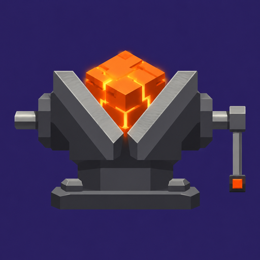

<div align="center">



# VISE

### Minecraft: Java Edition 26.3, rewritten in Rust

[](https://www.rust-lang.org)
[](LICENSE)
[](crates/vise-protocol)

**English** · [Русский](README.ru.md)

[Build](docs/en/build.md) · [Server](docs/en/server.md) · [Mods](docs/en/mods.md) · [Automation](docs/en/automation.md)

</div>

<br>

> [!NOTE]
> Unofficial fan project. Not affiliated with Mojang or Microsoft. Contains no Minecraft code or assets: Vise prepares them from **your own copy** of the game.

## Why Vise

<table>
<tr>
<td width="33%" valign="top">

### ⚡ Native
Own engine and renderer in Rust. HDR, controllers, DualSense.

</td>
<td width="33%" valign="top">

### 🧩 Moddable
Fabric-style API, `.vmod` files, WGSL shaders, modpack porting.

</td>
<td width="33%" valign="top">

### 🖥️ Server-ready
Headless server, backups, anticheat, Docker.

</td>
</tr>
<tr>
<td valign="top">

### 🤝 Together
Invite codes and an end-to-end encrypted tunnel.

</td>
<td valign="top">

### 🤖 Scriptable
`vise-ctl` and an MCP server for AI agents.

</td>
<td valign="top">

### ✅ Vanilla-accurate
Checked against the original game by parity tests.

</td>
</tr>
</table>

## Quick start

**From source:**

```sh
cargo build --release -p vise-client -p vise-prepare
./target/release/vise-prepare --prepare --server-jar path/to/server.jar
./target/release/vise-client
```

Windows: run `start-vise.bat`. Full guide: [docs/en/build.md](docs/en/build.md).

## Docs

| | |
|---|---|
| 🔨 [Build](docs/en/build.md) | Requirements, build, resources, controls |
| 🖥️ [Server](docs/en/server.md) | Run, manage, Docker, install |
| 🧩 [Mods](docs/en/mods.md) | Create and port mods |
| 🤖 [Automation](docs/en/automation.md) | `vise-ctl` and MCP |

## Repository

```
crates/      engine, client, server, protocol, mods, shaders
mods/        built-in and example mods
tests/       parity tests against vanilla
tools/       helper scripts
packaging/   installers, icons, Dockerfile
```

<div align="center">
<br>

MIT · Minecraft belongs to Mojang Studios and Microsoft

</div>
