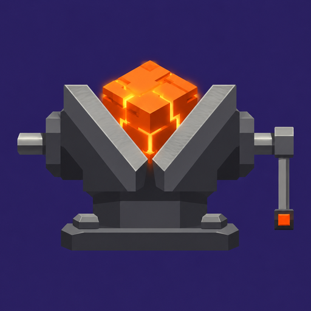

<div align="center">



# VISE

### Minecraft: Java Edition 26.3, переписанный на Rust

[](https://playvise.dev)
[](https://www.rust-lang.org)
[](LICENSE)
[](crates/vise-protocol)

[English](README.md) · **Русский**

[Сборка](docs/ru/build.md) · [Сервер](docs/ru/server.md) · [Моды](docs/ru/mods.md) · [Автоматизация](docs/ru/automation.md)

</div>

<br>

> [!NOTE]
> Неофициальный фанатский проект. Не связан с Mojang и Microsoft. Кода и ассетов Minecraft внутри нет: Vise готовит их из **вашей копии** игры.

## Почему Vise

<table>
<tr>
<td width="33%" valign="top">

### ⚡ Нативный
Свой движок и рендерер на Rust. HDR, геймпады, DualSense.

</td>
<td width="33%" valign="top">

### 🧩 Моддинг
API в духе Fabric, файлы `.vmod`, WGSL-шейдеры, перенос модпаков.

</td>
<td width="33%" valign="top">

### 🖥️ Для серверов
Headless-сервер, бэкапы, античит, Docker.

</td>
</tr>
<tr>
<td valign="top">

### 🤝 Вместе
Коды приглашений и сквозное шифрование.

</td>
<td valign="top">

### 🤖 Скрипты
`vise-ctl` и MCP-сервер для ИИ-агентов.

</td>
<td valign="top">

### ✅ Как в ванили
Сверяется с оригиналом parity-тестами.

</td>
</tr>
</table>

## Быстрый старт

**Проще всего:** лаунчер на **[playvise.dev](https://playvise.dev)**.

**Из исходников:**

```sh
cargo build --release -p vise-client -p vise-prepare
./target/release/vise-prepare --prepare --server-jar path/to/server.jar
./target/release/vise-client
```

Windows: запустите `start-vise.bat`. Подробнее: [docs/ru/build.md](docs/ru/build.md).

## Документация

| | |
|---|---|
| 🔨 [Сборка](docs/ru/build.md) | Требования, сборка, ресурсы, управление |
| 🖥️ [Сервер](docs/ru/server.md) | Запуск, управление, Docker, установка |
| 🧩 [Моды](docs/ru/mods.md) | Создание и перенос модов |
| 🤖 [Автоматизация](docs/ru/automation.md) | `vise-ctl` и MCP |

## Репозиторий

```
crates/      движок, клиент, сервер, протокол, моды, шейдеры
mods/        встроенные и примеры модов
tests/       parity-тесты против ванили
tools/       вспомогательные скрипты
packaging/   установщики, иконки, Dockerfile
```

<div align="center">
<br>

MIT · Minecraft принадлежит Mojang Studios и Microsoft

</div>
